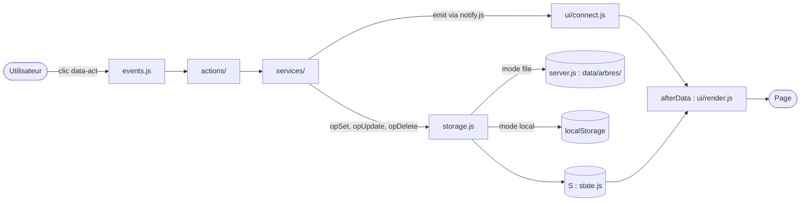
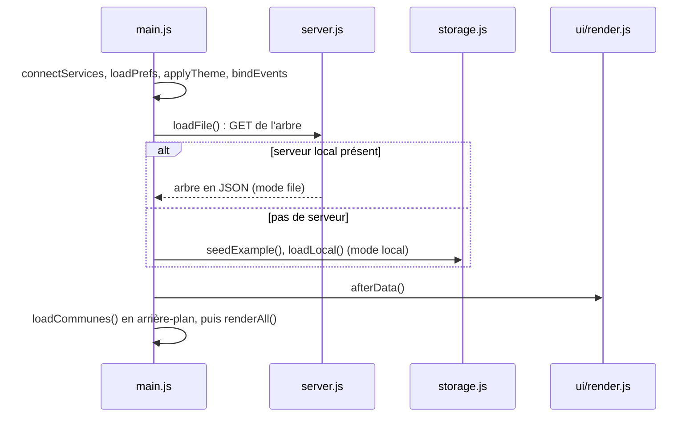
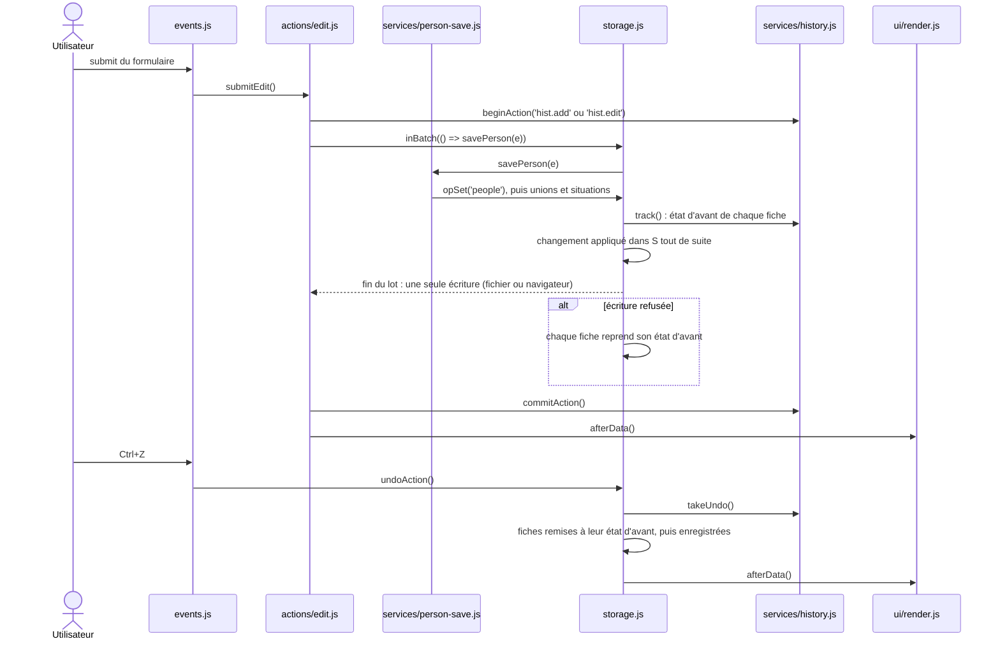
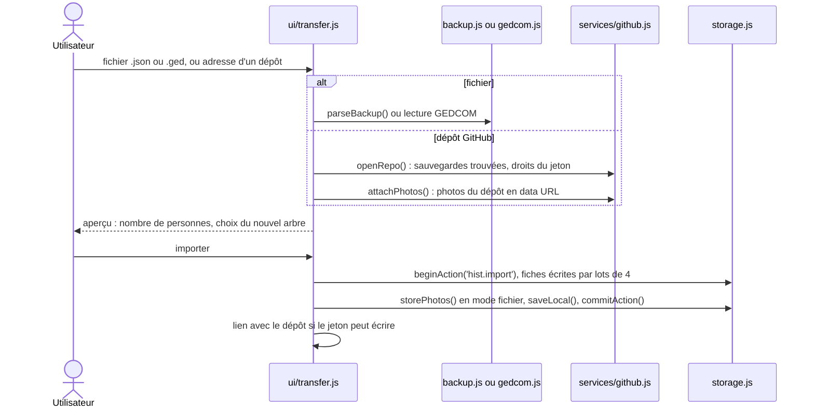
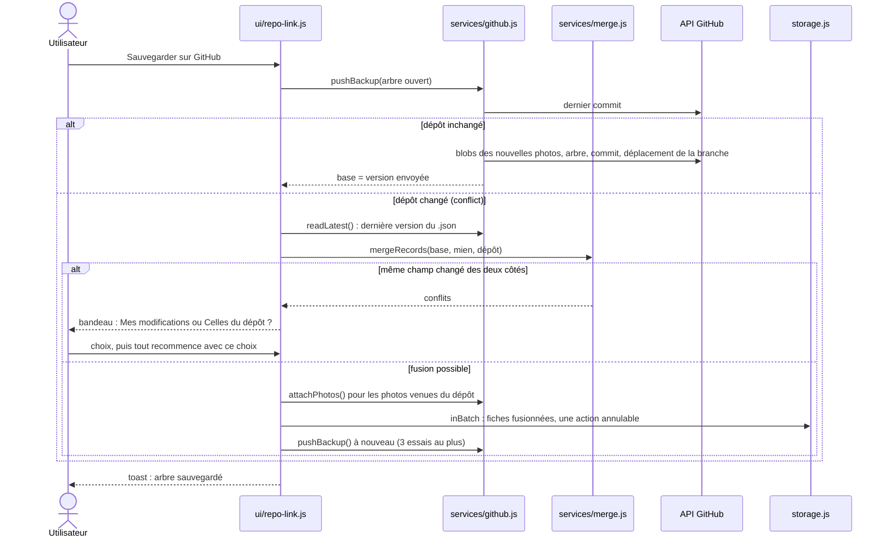
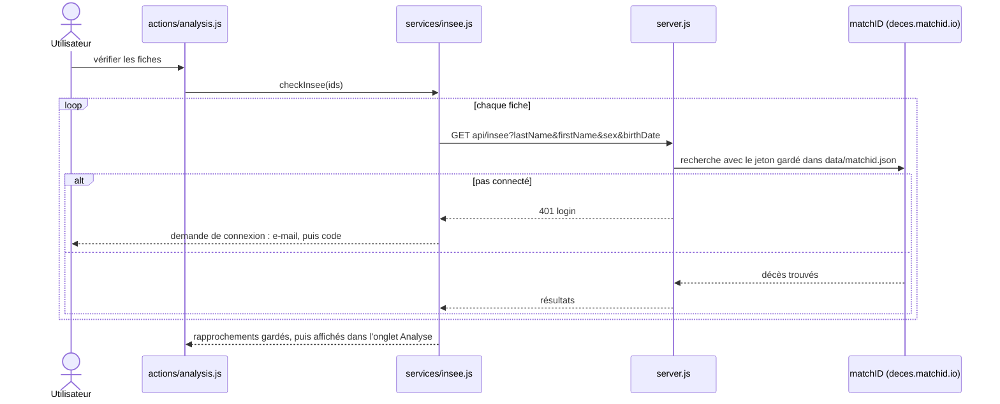
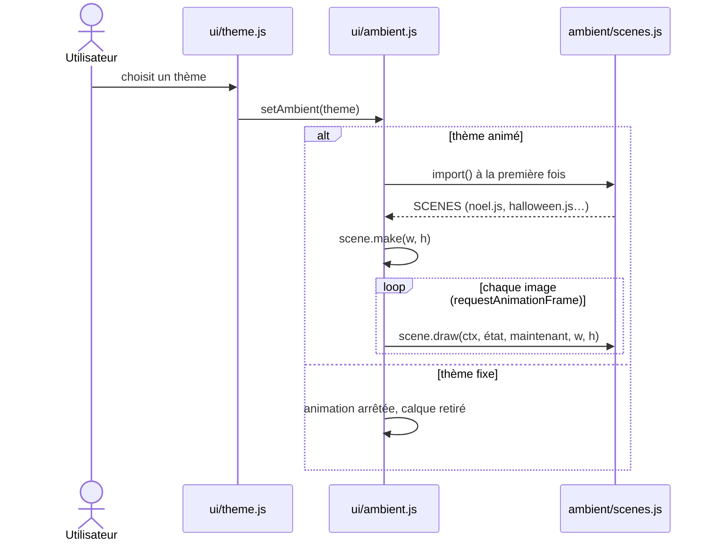

# Architecture

[← Documentation technique](DEVELOPMENT.md)

## Arborescence

```
lignee/
├── index.html                  Structure de la page
├── package.json                Scripts npm start et npm test, version de Node (26 ou plus)
├── .nvmrc                      Version de Node pour nvm (26)
├── .gitignore                  Exclut vos arbres et photos du dépôt
├── .github/workflows/ci.yml    Intégration continue : tests, puis version automatique
├── .releaserc.json             Réglages du calcul des versions
├── scripts/build-site.sh       Prépare le site GitHub Pages
├── scripts/release-notes.mjs   Notes de version, en anglais puis en français
├── scripts/check-french.mjs    Vérifie que chaque commit des notes a son texte français
├── renovate.json               Mises à jour automatiques proposées par Renovate
├── CHANGELOG.md                Historique des versions (généré)
├── docs/                       Documentation technique (sommaire : DEVELOPMENT.md)
├── server.js                   Serveur local : sert l'application, écrit data/arbres/
├── htr.js                      Lecture des écritures anciennes sur cet ordinateur (Kraken), pour server.js
├── voice.js                    Commandes à la voix sur cet ordinateur (Whisper, Ollama), pour server.js
├── scripts/whisper-worker.py   Programme Whisper lancé par voice.js, gardé en mémoire
├── assets/
│   └── favicon.svg             Icône de l'onglet
├── images/
│   └── avatar_femme.jpeg, avatar_homme.jpeg, avatar_neutre.jpeg   Avatars par défaut des fiches
├── css/
│   ├── tokens.css              Couleurs (thèmes clair et sombre), polices
│   ├── base.css                Remise à zéro, typographie, utilitaires
│   ├── layout.css              Grille de la page, adaptation mobile
│   └── components/
│       ├── controls.css        Boutons, champs de saisie
│       ├── badges.css          Pastille d'état, numéro Sosa, symbole du sexe
│       ├── header.css          En-tête, bandeau
│       ├── tree.css            Barre d'outils, toile, traits, fiches de l'arbre
│       ├── panel.css           Onglets, fiche détaillée
│       ├── form.css            Formulaire d'ajout et de modification
│       ├── register.css        Liste par nom de famille
│       ├── search.css          Recherche rapide et suggestions
│       ├── modal.css           Fenêtres Importer et Exporter
│       ├── person.css          Fiche d'une personne en fenêtre
│       ├── print.css           Fenêtre Imprimer, feuille imprimée
│       ├── trees.css           Bouton « Arbre », fenêtre Mes arbres
│       ├── analysis.css        Onglet Analyse, sources, roue d'ascendance, galerie
│       └── toast.css           Messages de confirmation
├── js/
│   ├── main.js                 Point d'entrée : choix du stockage, démarrage
│   ├── data/                   Données générées : communes, anciennes communes, constellations
│   ├── config.js               Constantes (dimensions, zoom, mois, clés)
│   ├── state.js                État partagé, préférences d'affichage
│   ├── events.js               Écoute des clics (attribut data-act) et saisies
│   ├── i18n.js                 Langue de l'interface, t(), bouton FR / EN
│   ├── i18n/
│   │   ├── fr.js               Textes en français
│   │   ├── en.js               Textes en anglais (une clé absente reprend le français)
│   │   └── grammar.js          Pluriels, accords, élisions, termes de parenté
│   ├── actions.js              Actions, regroupées ci-dessous
│   ├── actions/
│   │   ├── view.js             Personne centrale, onglets, générations, zoom, thème, annuler
│   │   ├── edit.js             Formulaire, enregistrement, suppression, famille d'exemple
│   │   └── analysis.js         Parenté, frise, doublons, lieux, décès INSEE
│   ├── utils/
│   │   ├── dom.js              Sélection, échappement HTML
│   │   ├── helpers.js          Identifiants, recherche sans accents, file d'attente
│   │   ├── dates.js            Lecture et affichage des dates
│   │   └── image.js            Réduction des photos
│   ├── model/
│   │   ├── people.js           Noms, âges, parents, conjoints, enfants, événements, sources
│   │   ├── media.js            Galerie de l'arbre, à part des fiches : images et personnes identifiées
│   │   ├── sources.js          Sources partagées : citations, documents de l'import GEDCOM
│   │   ├── voice.js            Commandes à la voix : la commande, la consigne du modèle, les phrases connues
│   │   ├── kinship.js          Lien de parenté entre deux personnes
│   │   ├── occupations.js      Traduction des professions à l'affichage
│   │   ├── book-branches.js    Livre de famille complet : chapitres par branche
│   │   ├── checks.js           Vérification de cohérence
│   │   ├── duplicates.js       Doublons probables, fiche fusionnée
│   │   ├── stats.js            Statistiques de l'arbre
│   │   ├── ephemerides.js      Anniversaires du jour et du mois
│   │   ├── timeline.js         Frise chronologique
│   │   ├── history-data.js     Repères historiques de la frise
│   │   ├── places.js           Lieux cités, migrations
│   │   ├── countries.js        Pays (français, anglais) du champ Pays des lieux
│   │   ├── insee.js            Rapprochement avec le fichier des décès de l'INSEE
│   │   ├── narrative.js        Récit du livret de famille de l'arbre
│   │   ├── family-book.js      Livret de famille d'une personne
│   │   ├── draft.js            Vérification du formulaire avant l'enregistrement
│   │   └── generations.js      Génération de chaque personne (arbre complet, statistiques)
│   ├── services/
│   │   ├── storage.js          Enregistrement et collection d'arbres : choisit le mode ci-dessous
│   │   ├── storage/
│   │   │   ├── trees.js        Règles communes à la collection d'arbres
│   │   │   ├── file.js         Mode fichier (server.js), photos en fichiers
│   │   │   └── local.js        Mode navigateur (localStorage)
│   │   ├── htr.js              Lecture d'une photo par le serveur local (Kraken)
│   │   ├── voice.js            Voix : micro, Whisper et Qwen du serveur ou du navigateur
│   │   ├── gedcom.js           Export et import GEDCOM 5.5.1
│   │   ├── github.js           Lecture d'une sauvegarde et de ses photos dans un dépôt GitHub, envoi
│   │   ├── merge.js            Fusion à trois voies des fiches (sauvegarde GitHub)
│   │   ├── backup.js           Sauvegarde complète au format JSON
│   │   ├── csv.js              Export du registre en CSV
│   │   ├── history.js          Historique annuler / rétablir
│   │   ├── notify.js           Messages des services vers l'interface, sans dépendre d'elle
│   │   ├── person-save.js      Enregistrement d'une fiche : unions et situations tenues à jour
│   │   ├── geocode.js          Coordonnées des lieux (OpenStreetMap, sur demande)
│   │   └── insee.js            Vérification des fiches chez matchID, résultats gardés
│   ├── tree/
│   │   ├── layout.js           Calcul des positions de l'arbre
│   │   ├── full-layout.js      Arbre complet, à plat, par génération
│   │   ├── fan.js              Roue d'ascendance (SVG, écran et impression)
│   │   ├── tiles.js            Découpage d'un dessin sur plusieurs feuilles
│   │   └── render.js           Dessin des fiches et des traits
│   └── ui/
│       ├── render.js           Rendu général
│       ├── connect.js          Branche les messages des services (notify.js) sur la page
│       ├── dialogs.js          Fenêtres ouvertes : Échap, clic sur le fond, raccourcis bloqués
│       ├── header.js           En-tête, bandeau, barre d'outils
│       ├── record.js           Fiche détaillée d'une personne
│       ├── person-dlg.js       Fiche d'une personne en fenêtre, au clic dans l'arbre
│       ├── form.js             Formulaire
│       ├── register.js         Registre par nom de famille
│       ├── search.js           Recherche rapide de l'en-tête
│       ├── repo-link.js        Bandeau du dépôt GitHub lié et envoi de l'arbre
│       ├── transfer.js         Fenêtres Importer et Exporter
│       ├── print.js            Impression : arbre, roue (une ou plusieurs feuilles), livret (A4)
│       ├── booklet.js          Pages du livret de famille
│       ├── analysis.js         Onglet Analyse
│       ├── places.js           Carte des lieux en SVG
│       ├── media.js            Visionneuse de la galerie, identification sur les photos
│       ├── reading.js          Lecture d'un document : image, texte lu, corrections
│       ├── voice.js            Le micro et la bulle des commandes à la voix
│       ├── trees.js            Fenêtre Mes arbres : ouvrir, créer, renommer, supprimer
│       ├── spouse-pick.js      Choix d'un conjoint existant
│       ├── theme.js            Thème choisi, couleurs, calque animé
│       ├── ambient.js          Animation des thèmes : lance la scène, une image à la fois
│       ├── ambient/
│       │   ├── scenes.js       Liste des scènes, chargée au premier thème animé
│       │   └── scenes/         Une scène par thème (noel.js, galaxie.js…) et shared.js
│       └── toast.js            Messages
├── test/                       Tests (node --test), un fichier par module
│   ├── setup.js                Faux navigateur minimal (éléments, événements, localStorage)
│   └── helpers.js              Famille d'exemple, arbre en mémoire
└── data/
    └── arbres/                         Vos arbres, un fichier .json chacun (créés par server.js)
        └── exemple-famille-bertrand.json   Famille d'exemple, seul fichier de ce dossier dans git
```

## Circulation des données

### En bref

Toute la page tourne autour d'un objet partagé, `S` (dans `state.js`) : l'arbre ouvert
(`S.people`, `S.unions`), la personne au centre (`S.focus`), l'onglet, le formulaire en cours,
le mode de stockage (`S.mode`). Le code suit toujours le même chemin :

1. **Un clic** : `events.js` lit l'attribut `data-act` du bouton et appelle l'action correspondante.
2. **Une action** (`actions/`) prépare le changement et appelle un service.
3. **Un service** (`services/`) écrit avec `opSet`, `opUpdate` ou `opDelete` de `storage.js`.
   Le changement s'applique d'abord dans `S`, puis part vers le stockage du mode choisi.
4. **`afterData()`** (`ui/render.js`) recalcule les index (parents, enfants, conjoints) et
   redessine la page à partir de `S`.

Les services ne connaissent pas l'interface : ils préviennent la page par `notify.js`
(`emit('data')`, `say('message')`), et `ui/connect.js` relie ces messages au rendu et aux toasts.



### Démarrage : choix du stockage

`main.js` choisit le mode une fois pour toutes : le serveur local s'il répond, sinon le navigateur.



### Modifier une fiche, puis annuler

Une action qui touche plusieurs fiches passe par `inBatch()` : tout est enregistré en une fois,
ou tout revient en arrière. `beginAction` et `commitAction` en font une seule entrée de l'historique.



### Importer un fichier ou un dépôt



### Sauvegarder sur GitHub, avec fusion

Si quelqu'un a sauvegardé entre-temps, Lignée fusionne sa version avec l'arbre ouvert, champ
par champ, en partant de la version chargée (`services/merge.js`). Le détail est dans
[GitHub](features/github.md).



### Vérifier un décès auprès de l'INSEE

Le navigateur ne parle pas directement à matchID : le serveur local relaie la demande et garde
la connexion. Seuls le nom, le prénom, le sexe et la date de naissance partent.



### Thème animé

Les scènes ne sont chargées qu'au premier thème animé affiché, puis dessinées image par image
sur un calque sous l'arbre. Chaque thème a son fichier dans `js/ui/ambient/scenes/`.



### Règles qui en découlent

- `events.js` écoute les clics une seule fois pour toute la page. Chaque bouton
  porte un attribut `data-act` (par exemple `data-act="add" data-rel="father"`)
  qui renvoie à une fonction de `actions.js`.
- Ne jamais modifier `S.people` ou `S.unions` directement dans une action : passer par
  `opSet`, `opUpdate` ou `opDelete`. Sinon le changement n'est ni enregistré ni annulable.
- Après un changement de données, appeler `afterData()` ; pour un simple changement
  d'affichage (onglet, zoom), `renderAll()` suffit.
- Une action qui touche plusieurs fiches (enregistrer, supprimer, fusionner, renommer un lieu…)
  passe par `inBatch()` : ses changements s'appliquent tout de suite en mémoire, mais sont
  enregistrés ensemble à la fin, en une seule écriture. Si l'enregistrement
  échoue, tout revient en arrière : l'action est enregistrée entière ou pas du tout.
- Le HTML est construit en chaînes : toute donnée saisie passe par `esc()` (`utils/dom.js`).

## Langue

Le bouton FR / EN de l'en-tête passe toute l'interface en français ou en anglais ;
le choix est mémorisé dans le navigateur. Les textes sont dans `js/i18n/fr.js` et `js/i18n/en.js` : `t('clé')`
dans le code, attributs `data-i18n`, `data-i18n-html` et `data-i18n-attr` dans `index.html`.
Les dates se saisissent dans les deux langues (« vers 1850 » ou « about 1850 ») et
s'affichent dans la langue choisie. Les données saisies (noms, lieux, notes) ne sont pas traduites,
sauf les professions connues du dictionnaire de `js/model/occupations.js`, traduites à l'affichage :
la valeur enregistrée, le formulaire et les exports gardent le texte saisi.

## Annuler / rétablir

Les boutons Annuler et Rétablir de la barre d'outils, ou Ctrl+Z, Ctrl+Maj+Z et Ctrl+Y (hors
d'un champ de saisie), portent sur les enregistrements, suppressions, fusions, imports et
identifications sur les photos. Une action retient uniquement les fiches qu'elle a modifiées,
avant et après. L'historique (50 actions) reste en mémoire : il disparaît au rechargement de la
page et au changement d'arbre.
